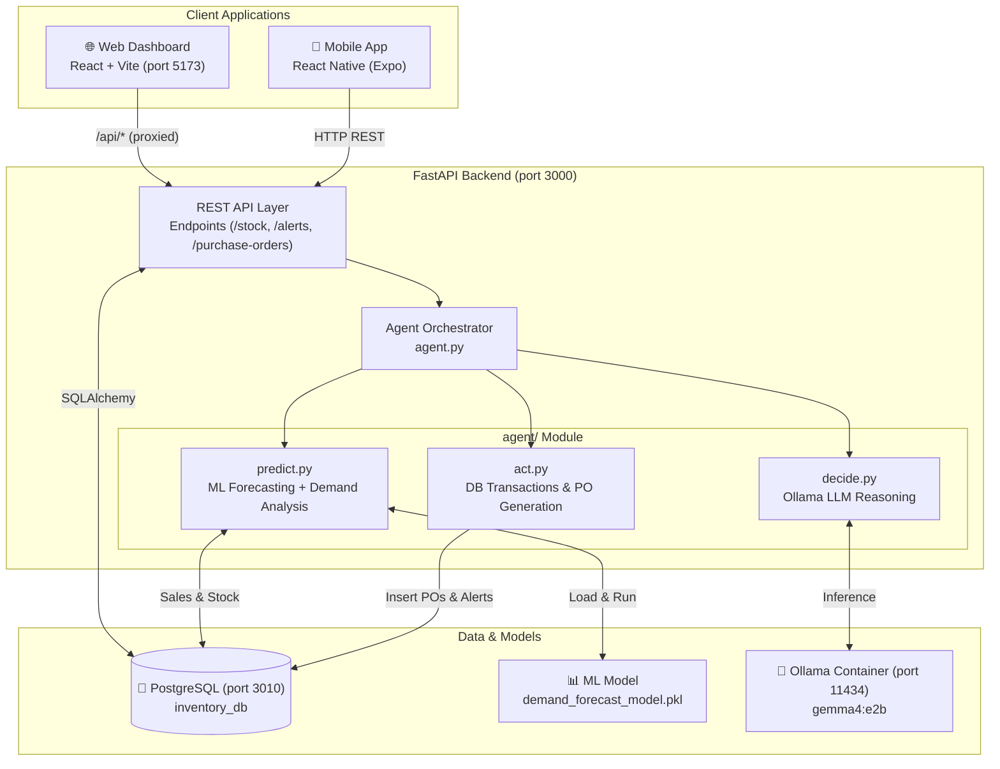
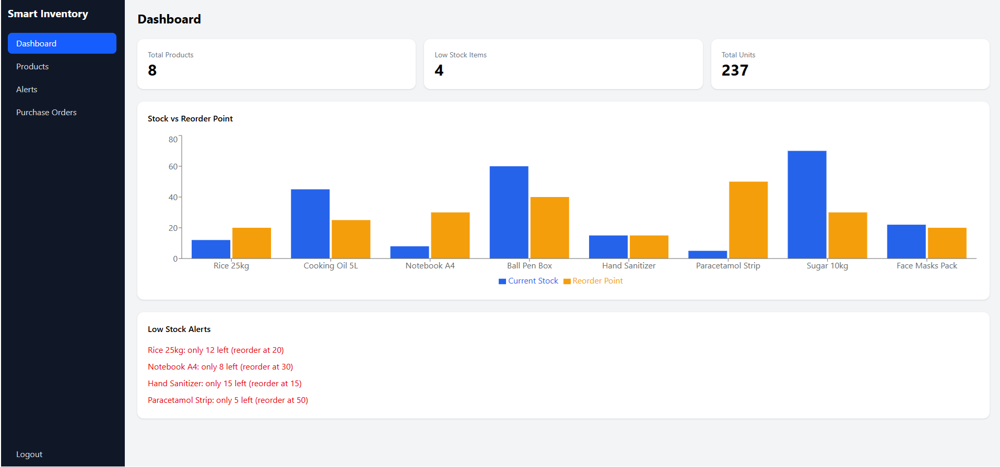
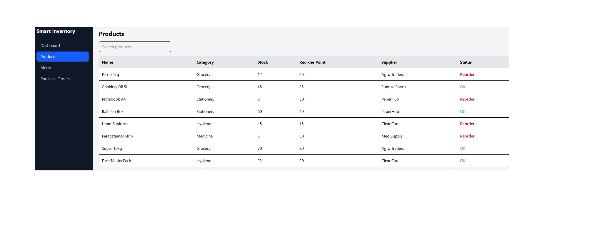
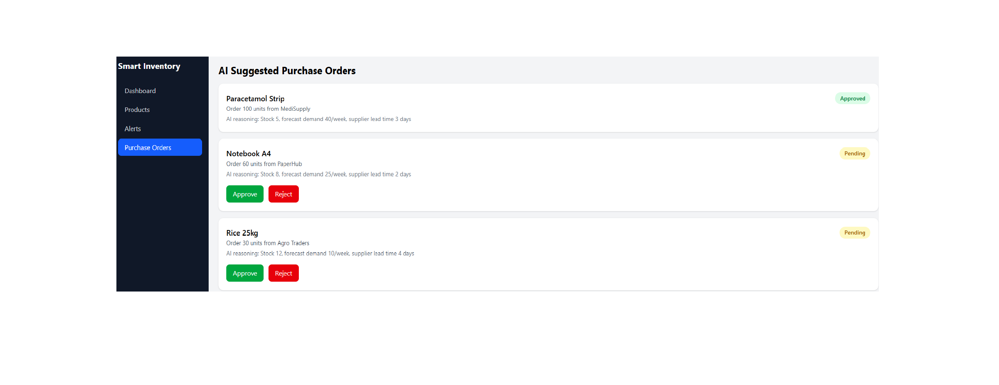
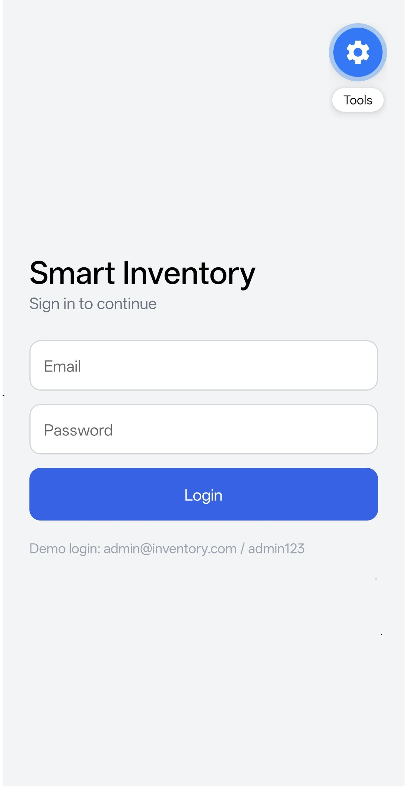
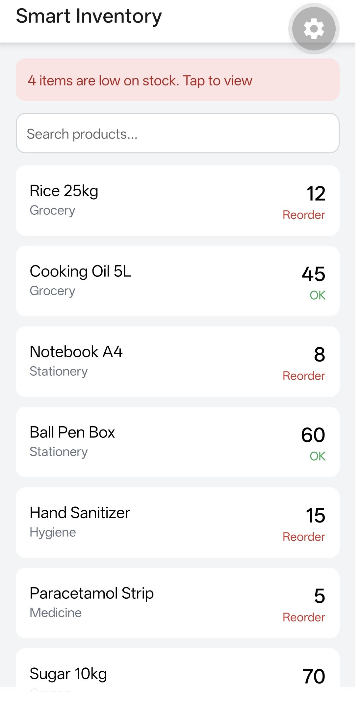
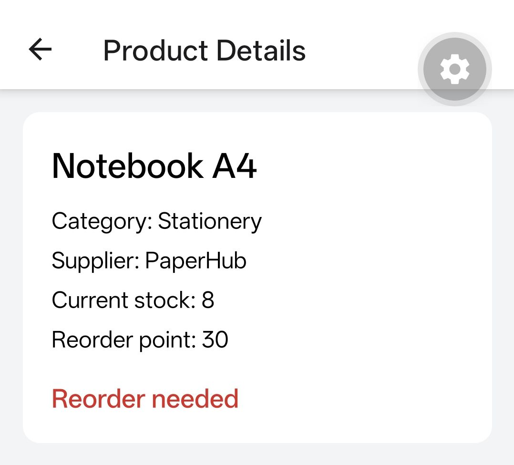

# Smart Inventory Management Agent

An AI-powered inventory system that continuously monitors stock levels, forecasts future demand using machine learning, and recommends automated purchase orders and markdown actions using local LLMs.

**Live demo (web):** https://smart-inventory-agent.vercel.app  
**Demo login:** `admin@inventory.com` / `admin123`

---

## Problem
Small shops, grocery stores, and retail businesses frequently suffer from stockouts of essential items or overstocking perishable goods that spoil before they can be sold. Manual stock tracking leads to lost revenue, wasted inventory, and inefficient purchasing decisions.

## Solution
A full-stack, closed-loop AI agent that monitors inventory, predicts sales, and takes action:
1. **Observe**: Ingests real-time stock levels, expiring batch data, lead times, and continuous sales histories from PostgreSQL.
2. **Predict**: Uses a trained `GradientBoostingRegressor` time-series model to forecast multi-day demand per SKU and compute dynamic safety stock reorder points.
3. **Decide**: Evaluates at-risk items using an Ollama LLM (`gemma4:e2b`) to choose optimal actions (`ORDER`, `MARKDOWN`, `HOLD`) with automated quantity boundary checks.
4. **Act**: Writes supplier-grouped draft purchase orders and markdown alerts directly to PostgreSQL for manager approval.

---

## Features
- **Interactive Dashboard**: Stock health metrics, active alerts summary, and live stock vs. reorder point visualizations.
- **Product Management**: SKU catalogue with stock status badges (`OK` vs `Reorder`) and real-time search.
- **Automated Alerts**: Real-time alerts for low stock levels and batches nearing expiration.
- **AI Purchase Orders**: Auto-generated supplier purchase orders with approval/rejection workflows and state transitions (`DRAFT` → `APPROVED` → `SENT` → `RECEIVED`).
- **One-Click Agent Trigger**: On-demand execution of the Observe → Predict → Decide → Act cycle directly from the web interface.
- **Mobile Companion App**: Expo/React Native mobile app for on-the-go stock checking and alerts.

---

## Tech Stack

| Layer | Technology |
|---|---|
| **Web Frontend** | React 19, Vite, Tailwind CSS, Recharts, Axios, React Router |
| **Mobile App** | React Native (Expo) |
| **Backend API** | FastAPI, Uvicorn, SQLAlchemy, Pydantic |
| **Database** | PostgreSQL (Port 3010) with triggers, views & stored procedures |
| **Demand Forecasting** | Python, Scikit-Learn (`GradientBoostingRegressor`), Pandas, NumPy |
| **Decision LLM** | Ollama (`gemma4:e2b`), Docker |
| **Deployment** | Vercel (web), Docker Compose (LLM service) |

---

## Architecture



---

## Port Map

| Service | Port | Description |
|---|---|---|
| **Web Frontend** | `5173` | React/Vite development server |
| **Backend API** | `3000` | FastAPI server (`http://localhost:3000`) |
| **API Docs (Swagger)** | `3000` | Interactive docs at `http://localhost:3000/docs` |
| **PostgreSQL Database** | `3010` | Database service (`localhost:3010/inventory_db`) |
| **Ollama LLM Service** | `11434` | Ollama API endpoint serving `gemma4:e2b` |

---

## Project Structure

```
smart-inventory-agent/
├── backend/
│   ├── agent/                      # Modular agent pipeline
│   │   ├── __init__.py             # Package exports
│   │   ├── predict.py              # ML forecasting & inventory analysis
│   │   ├── decide.py               # Ollama decision engine & rule validator
│   │   └── act.py                  # Transactional PO and alert creation
│   ├── model/                      # ML models
│   │   └── demand_forecast_model.pkl # Trained Scikit-Learn regression model
│   ├── .env                        # Database & Ollama environment config
│   ├── agent.py                    # Main agent orchestrator CLI & cycle runner
│   ├── database.py                 # SQLAlchemy engine configuration
│   ├── main.py                     # FastAPI REST API application
│   └── requirements.txt            # Python dependencies
├── frontend/                       # React web dashboard
│   ├── src/
│   │   ├── api.js                  # Axios client connecting to backend API
│   │   ├── pages/                  # Dashboard, Products, Alerts, PurchaseOrders, Login
│   │   ├── components/             # Navigation layout and common widgets
│   │   └── App.jsx                 # Routing and authentication state
│   ├── vite.config.js              # Dev proxy configuration (/api -> port 3000)
│   └── package.json
├── mobile/                         # React Native Expo companion app
│   ├── screens/                    # Mobile screens (StockList, Alerts, Login, Product)
│   └── App.js
├── db/
│   ├── inventory_db.sql            # PostgreSQL schema, views, triggers & seed data
│   └── inventory.db                # SQLite demo snapshot
├── scripts/
│   ├── start-all.sh                # Single-command startup for all services
│   ├── setup-llm.sh                # Starts Ollama Docker container and pulls model
│   └── setup-db-port.sh            # Sets PostgreSQL port to 3010
├── docker-compose.yml              # Container definition for Ollama LLM
└── README.md
```

---

## How to Run Locally

### Prerequisites
- Node.js (v18+) & npm
- Python (v3.10+)
- PostgreSQL (v14+)
- Docker & Docker Compose

---

### Option 1: Docker Runtime (Recommended)

Run the complete multi-service stack (PostgreSQL, Ollama LLM, FastAPI backend, and React frontend) with a single command:

```bash
docker compose up -d
```

This starts:
- 🐘 **PostgreSQL** on port `3010` (auto-seeded with schema, views, and initial data from `db/inventory_db.sql`)
- 🐳 **Ollama** on port `11434`
- ⚡ **FastAPI Backend** on port `3000`
- 🌐 **React Frontend** on port `5173`

To pull the decision LLM model into Ollama:
```bash
docker exec -it smart-inventory-ollama ollama pull gemma4:e2b
```

---

### Option 2: Local Startup Script (Native Services)

You can launch all services natively using the startup script:

```bash
bash scripts/start-all.sh
```

---

### Option 3: Step-by-Step Manual Setup

#### 1. Database Setup (Port 3010)
Restore the database schema and seed data into PostgreSQL:
```bash
createdb -p 5432 -U postgres inventory_db
psql -p 5432 -U postgres -d inventory_db -f db/inventory_db.sql
```

To configure PostgreSQL to run on port `3010` (as expected by the project):
```bash
sudo bash scripts/setup-db-port.sh
```

#### 2. LLM Container Setup (Ollama)
Start the Ollama Docker container and pull the `gemma4:e2b` model:
```bash
bash scripts/setup-llm.sh
```
Or manually via Docker Compose:
```bash
docker compose up -d ollama
docker exec -it smart-inventory-ollama ollama pull gemma4:e2b
```

#### 3. Backend Setup
```bash
cd backend
python3 -m venv ../venv
source ../venv/bin/activate
pip install -r requirements.txt

# Run the backend API server (port 3000)
python main.py
```
* Interactive Swagger API documentation: [http://localhost:3000/docs](http://localhost:3000/docs)

To test the agent cycle standalone from the CLI:
```bash
# Dry run: evaluates inventory and prints plan without writing to DB
python agent.py --dry-run

# Live run: executes forecasts, updates reorder rules, and writes draft POs
python agent.py --run

# Inspect ML model features
python agent.py --inspect
```

#### 4. Frontend Web App
```bash
cd frontend
npm install
npm run dev
```
Open [http://localhost:5173](http://localhost:5173) in your browser. All API requests (`/api/*`) are proxied automatically to the backend on port `3000`.

#### 5. Deploying to Vercel
To deploy the web frontend to Vercel:
1. Connect your repository to [Vercel](https://vercel.com).
2. The project includes [vercel.json](file:///home/rishin/smart-inventory-agent/vercel.json) at the root and in `frontend/` with SPA rewrites and Vite build settings configured.
3. In your Vercel Project Settings under **Environment Variables**, add:
   ```
   VITE_API_BASE_URL=https://your-backend-api-url.com
   ```
   (This tells the frontend Axios client to call your deployed backend instead of the local dev proxy).
4. Click **Deploy**.

#### 6. Mobile App
```bash
cd mobile
npm install
npx expo start
```
Scan the QR code with the Expo Go app on iOS or Android.

---

## Key API Endpoints

| Method | Endpoint | Description |
|---|---|---|
| `GET` | `/` | API status and service links |
| `GET` | `/stock` | Current stock levels, batch aggregations, and reorder points |
| `GET` | `/products` | Active product catalogue |
| `GET` | `/alerts` | Open, unresolved inventory alerts (`LOW_STOCK`, `NEAR_EXPIRY`, `MARKDOWN`) |
| `GET` | `/purchase-orders` | List purchase orders and their line items |
| `PATCH` | `/purchase-orders/{id}` | Approve, reject, or mark purchase orders as received |
| `POST` | `/agent/run` | Triggers a full automated agent cycle |
| `GET` | `/daily-sales` | Aggregated daily unit sales history |
| `GET` | `/forecasts` | Future demand predictions generated by the ML model |

---

## SDG Goals
- **SDG 12, Responsible Consumption and Production:** Minimizes food and goods spoilage through predictive expiration tracking and demand-matched ordering.
- **SDG 9, Industry, Innovation and Infrastructure:** Brings enterprise-grade autonomous forecasting tools to small and local retail shops.
- **SDG 8, Decent Work and Economic Growth:** Reduces repetitive manual data entry, enabling store managers to focus on core operations.

---

## Screenshots

### Web




### Mobile
<p>
  
  
  
</p>

---

## Team

| Name | Role | GitHub |
|---|---|---|
| **Shivangini** | Frontend | [Shivangini25](https://github.com/Shivangini25) |
| **Rishin** | Backend | [AlloyTUBER](https://github.com/AlloyTUBER) |
| **Sristi** | Database | [sealsristi](https://github.com/sealsristi) |
| **Suvanil** | AI Agent | [suvanilreviews-svg](https://github.com/suvanilreviews-svg) |
